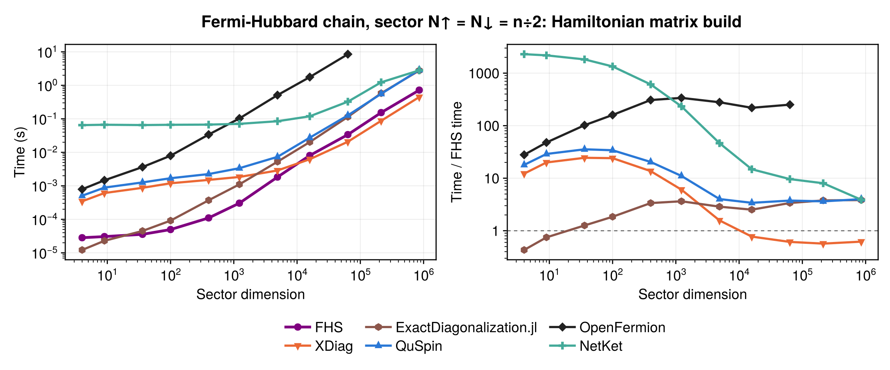
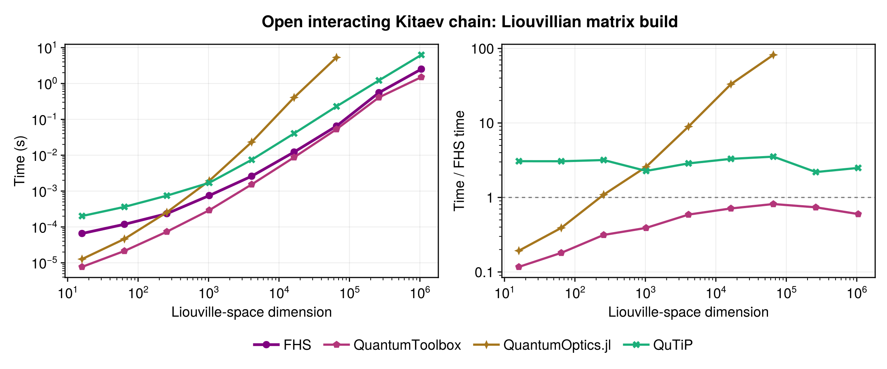
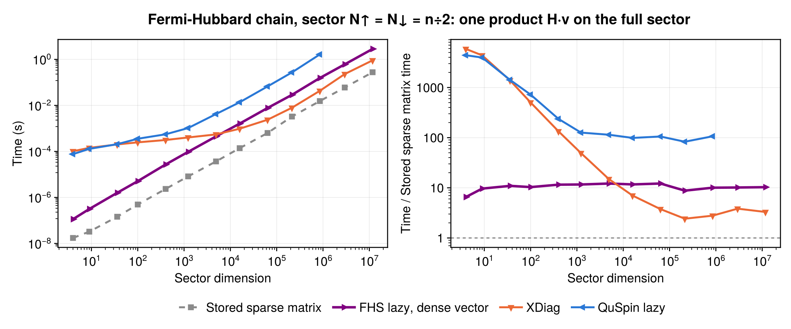

# Benchmarks

The figures compare FermionicHilbertSpaces.jl (v0.10, Julia 1.13, single thread) with other libraries on the same models, using the minimum time over repeated runs. Each library builds its operators from its own operator description, and the resulting matrices are checked to agree up to a change of basis.

## Hamiltonian in a particle-number sector

Building the sparse Fermi-Hubbard Hamiltonian in a fixed-particle-number sector, basis construction included: FHS is the fastest for small and medium sectors, and XDiag overtakes it for the largest ones.

## Liouvillians

Building the Liouvillian of an open Kitaev chain with loss: FHS is faster than QuTiP and QuantumOptics.jl, which scales worse, and slightly slower than QuantumToolbox.

## Matrix-free products

Applying the Hubbard Hamiltonian to a vector without storing the matrix: FHS's lazy operator is faster than QuSpin's and than XDiag's for small sectors, XDiag is faster for large ones, and all are slower than a stored sparse matrix, which stops fitting in memory first.

See [Parallelization](misc.md) for multithreaded builds.
